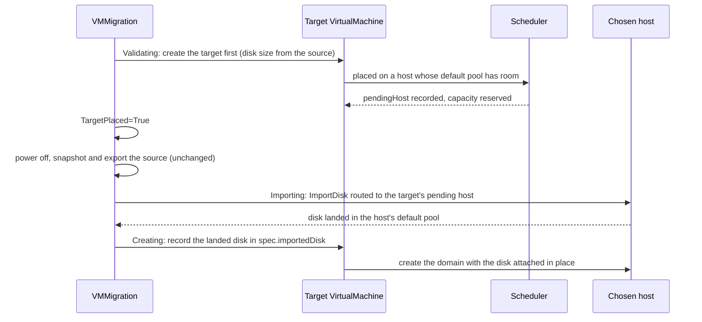

<!--
Copyright (c) 2026 VirtRigaud Creators
SPDX-License-Identifier: Apache-2.0
-->

# Migrating into a clustered libvirt Provider (experimental)

Since **v0.4.0** a `VMMigration` can target a libvirt Provider with
`spec.topology: cluster`. In v0.3.11 and earlier such a migration failed at
`Validating`.

!!! warning "Experimental"
    Clustered Providers are experimental in v0.4.0 and may still change. This
    page covers what is different when the **target** is clustered. Everything
    else about `VMMigration` (staging backends, source options, phases, the
    cleanup policies) is in the [User Guide](user-guide.md), the
    [API Reference](api-reference.md) and the
    [architecture guide](vm-migration-guide.md); this page does not repeat it.
    For the clustered Provider itself see
    [Clustered libvirt: overview and setup](../guides/clustered/index.md).

## Example

```yaml
apiVersion: infra.virtrigaud.io/v1beta1
kind: VMMigration
metadata:
  name: app-into-cluster
  namespace: default
spec:
  source:
    vmRef:
      name: app-on-libvirt            # a VM on a single-host libvirt Provider
    powerOffBeforeMigration: true
  target:
    name: app-on-cluster
    providerRef:
      name: libvirt-cluster           # a libvirt Provider with spec.topology: cluster
      namespace: virtrigaud-system    # another namespace: needs a consumer grant, see below
    classRef:
      name: standard-2cpu-4gb
    # placementRef:                   # optional: steer the target VM's placement
    #   name: spread-web
    powerOn: true
  storage:
    type: nfs                         # or s3. Must be set: "pvc" (what an unset storage means) is refused
    nfs:
      server: nfs.example.com
      export: /export/virtrigaud
      uid: 1000
      gid: 1000
  options:
    cleanupPolicy: OnSuccess
    verifyChecksums: true
```

The same file is
[`examples/vmmigration-into-clustered.yaml`](https://github.com/projectbeskar/virtrigaud/blob/v0.4.0/examples/vmmigration-into-clustered.yaml).
Replace the NFS server with your own.

## How it differs from a single-host target

With a single-host, vSphere or Proxmox target, the migration imports the disk
and then creates the target VM. With a clustered target the disk has to land on
the host where the VM will run, so the order changes:



1. **`Validating`: the target VM is created first**, before the source is
   powered off, snapshotted or exported. The migration reads the source disk's
   virtual size and creates the target `VirtualMachine` with
   `spec.importedDisk` naming the migration but **no disk yet** (an empty
   `diskID`, accepted by the CRD only while `migrationRef` is set). The VM
   controller places it like any clustered VM, keeping only hosts whose
   `Host.status.allocatableStorageBytes` holds the disk (the source disk's
   virtual size, rounded up to whole GiB), and reserves its capacity from then
   on. The VM shows `Provisioning=False/WaitingForImport` and no `Create` is
   sent.
2. The migration waits with condition **`TargetPlaced`** until the target has a
   pending host. Until then the source is not touched. Delete the
   `VMMigration` to give up; the unbound target is deleted with it.
3. **`Exporting`** is unchanged.
4. **`Importing`: the disk is imported on the placed host.** The import is sent
   to the target's pending host, and that host is recorded in
   `status.storageInfo.importTarget.host`. A re-send, and the cleanup of the
   landed and staged disks, go to that host only.
5. **`Creating`: no VM is created.** The landed disk is written into the
   existing target's `spec.importedDisk`, and the VM controller creates the
   domain on its pending host with the disk attached in place. The domain's
   disk is `<default pool>/<namespace>.<name>-migrated.qcow2`.
6. **`Ready`** is reached only if the target's `spec.importedDisk` is still
   exactly the disk this migration imported.

```sh
kubectl get vmmigration app-into-cluster -o jsonpath='{.status.storageInfo.importTarget.host}{"\n"}'
```

## Requirements

| Requirement | What happens without it |
|---|---|
| The target Provider is libvirt with `spec.topology: cluster` and its provider image reports `supports_routed_import` | The migration fails at `Validating` with `ClusteredTargetUnsupported`, before any side effect. The capability is read from the provider at runtime; it is not in `Provider.status.reportedCapabilities`. Upgrade the clustered provider first, then run the migration again |
| `spec.storage.type` is `s3` or `nfs`, set explicitly | `pvc` is refused at `Validating` (`MigrationFailed`, message "storage backend "pvc" is not supported into a clustered provider ..."). An unset `spec.storage` means `pvc` |
| The target VM is in the VMMigration's own namespace (`spec.target.namespace` unset or equal to it) | Fails at `Validating` with `ClusteredTargetUnsupported`. The target VM proves its landed disk through a VMMigration in its own namespace |
| If the Provider is in another namespace, its `spec.consumerNamespaceSelector` selects the migration's namespace | The migration is refused as `ConsumerNotAllowed`. See [cross-namespace references](https://github.com/projectbeskar/virtrigaud/blob/v0.4.0/docs/cross-namespace-references.md) |
| Hosts are `Ready`, schedulable, and report `status.allocatableStorageBytes` at least the source disk's size | The target waits unplaced (`TargetPlaced=False`, usually `Unschedulable`) and the source is not touched |
| The Provider runs one replica, and no other Provider mounts the same pool | The landing lock is per provider process; two Providers whose hosts mount one pool are not serialised against each other |

Check a host's figure with:

```sh
kubectl get host <host> -n <provider namespace> -o jsonpath='{.status.allocatableStorageBytes}{"\n"}'
```

It is the free space of the host's `default` pool only, measured with
`stat -f` on every Host sync (every 60 seconds), so it is up to a minute old
and excludes root-reserved blocks. A host reports `0` when its `default` pool
is inactive, of an unsuitable type, not at `/var/lib/libvirt/images`, or cannot
be measured in time; such a host is never chosen for a migration target.

### Host prerequisites

In addition to [Libvirt host preparation](../operations/libvirt-host-prepare.md)
and the clustered Provider's [Host objects](../guides/clustered/index.md), every
host that may be chosen needs:

- the **`default` storage pool**, already created, active, and at
  `/var/lib/libvirt/images`, with room for the staged object **and** the
  converted disk at once. The import never creates, starts or moves a pool. A
  host whose `default` pool is elsewhere refuses the import
  (`HOST_STORAGE_MISCONFIGURED`) and is excluded for this VM only;
- a **`qemu+ssh://` `Host` endpoint**;
- **`qemu-img`** (with CVE-2024-4467 fixed), **`flock`** (util-linux) and
  **`timeout`** (coreutils). A host without `flock` or `timeout` refuses the
  import and never runs it unguarded;
- the provider's **staging directory writable by the SSH user**. The import's
  host lock lives in its `virtrigaud-locks` subdirectory (mode `0700`, owned by
  the SSH user; anything else is refused);
- the **cloud-init seed directory** `/var/lib/libvirt/virtrigaud-seeds`. The
  import does not use it, but the create of the target VM that follows does. On
  a host without it, the create fails (retried) with `refusing to stage
  cloud-init data` **after** the disk has landed, and the VM stays uncreated
  until you fix the host. See
  [cloud-init seed directory](https://github.com/projectbeskar/virtrigaud/blob/v0.4.0/docs/libvirt-domain-ownership.md#cloud-init-seed-directory);
- the sudo rules a clustered Provider already needs for clones and exports
  (`qemu-img info -U` and the `timeout` lines). The import's own commands run
  as the SSH user, without `sudo`. See
  [what the copies run as root](https://github.com/projectbeskar/virtrigaud/blob/v0.4.0/docs/libvirt-clones.md#what-the-copies-run-as-root).

## Watching a migration

```sh
kubectl get vmmigration <name> \
  -o jsonpath='{range .status.conditions[*]}{.type}={.status}/{.reason}{"\n"}{end}'
kubectl describe virtualmachine <target name>      # the target VM's Placed and Provisioning conditions
```

Most holds below are re-checked by the manager on a backoff (15 seconds,
doubling up to 5 minutes, unless a row says otherwise), so a hold lifts by
itself once its cause is gone. The last column says where you must act.

### On the VMMigration

| Condition / reason | Meaning | What to do |
|---|---|---|
| `TargetPlaced=False/WaitingForPlacement`, or the target's own `Placed` reason (`Unschedulable`, `RestorePending`, `AllHostsExcluded`, ...) | The target VM exists but has no pending host. The source has not been powered off, snapshotted or exported | `kubectl describe virtualmachine <target name>`: the `Placed` message names the filter that rejected the hosts (for example insufficient storage for the VM's disk). Add a host, free pool space or fix labels. To give up, delete the VMMigration |
| `TargetPlaced=False/SourceDiskSizeUnknown` | The source disk's virtual size could not be read, so no target was created (placement needs it) | Check the source Provider and the source VM; the cause is in the manager log. It is retried and does not fail the migration for a size that cannot be read yet |
| `TargetPlaced=False/TargetVMDeleting` | A target VM from an earlier attempt is being deleted | Wait |
| `TargetPlaced=False/TargetHostReleased` | The landing host refused the import before writing anything (a foreign or unstamped domain with the target's name, or a `default` pool not at `/var/lib/libvirt/images`). That host is excluded for this target (`status.placement.excludedHosts` of the target VM), the target is placed again, and the import follows it | Nothing, unless every host refuses. Fix the refused host before the next migration |
| `Validating=False/TargetCapabilitiesUnknown` | The Provider's capabilities could not be read | Check the provider pod. Retried every 30 seconds |
| `Failed`, reason `ClusteredTargetUnsupported` or `MigrationFailed` | The Provider lacks `supports_routed_import`, the target VM is in another namespace, or the backend is `pvc` | Fix the cause and run the migration again |
| `Failed/TargetNotPending` | At `Validating`, `Importing` or `Creating` the target VM already has a provider id (it was created some other way), or at `Importing` it has no pending host (for example someone cleared it) | Delete the target `VirtualMachine` and run the migration again |
| `Importing=False/TargetHostUnavailable` | The landing host could not be reached, or another host the import must check could not be checked. Nothing was landed. The target is **never** moved off its host automatically | Restore the host. If it is gone for good, delete the VMMigration; if the target VM's own delete is then held (`DeleteBlocked`), set `virtrigaud.io/force-delete: "true"` on the target VM (it was never created on that host). If the Provider is in another namespace than the target VM, force-delete is honoured only when the Provider carries the annotation `infra.virtrigaud.io/allow-consumer-orphan-on-delete: "true"` (the target VM then shows `ForceDeleteRefused`); otherwise delete the VM after the host is back |
| `Importing=False/ImportTargetPreviousIncarnation` | The landing host holds a domain of a previous incarnation of the target VM | An administrator re-attaches or removes that domain: [Backup, restore and re-attach](../guides/clustered/backup-restore.md) |
| `Importing=False/LandingDiskInUse` | The landing file `<default pool>/<namespace>.<name>-migrated.qcow2` is used by a domain on a host of the Provider. The target is not re-placed, because on a shared pool that cannot help | An administrator resolves it (find the domain that uses the file) |
| `Importing=False/LandingHostRefused` | The landing host refused before writing: its lock directory or the landing name is not as the provider requires, a host tool is missing, or the endpoint is not `qemu+ssh://` | Fix the host; the cause is in the manager and provider logs |
| `Importing=False/ImportNotPerformed` | The host did not perform the import (another import of the disk was running, no room, or a host command failed). Nothing was landed. Retried on the same host | If this lasts 5 minutes the attempt fails (reason `ImportNotPerformed`) into `spec.options.retryPolicy`; with no policy the migration stays `Failed`. A retry deletes the unbound target and places a fresh one |
| `Ready=False/ImportOutcomeUnknown` | The import's outcome is not known (manager restart, deadline, dropped connection). It is re-checked every minute. On `s3` and `nfs` it is re-sent to the **recorded** host 35 minutes after the request, at most 3 times, then held for you. If the target's pending host changed since, it is held and not re-sent | Check the recorded host (`status.storageInfo.importTarget.host`) for `<default pool>/<namespace>.<name>-migrated.qcow2` and remove it if present. Then confirm the attempt as not performed (below) |
| `Ready=False/TargetHostMoved` | The target's pending host is not the host the disk was imported to, so the disk is not recorded on it | Set the target's `status.placement.pendingHost` back to `status.storageInfo.importTarget.host`, or delete the VMMigration |
| `Ready=False/TargetDiskMismatch` | The target's `spec.importedDisk` is not the disk this migration imported (someone changed it). The migration is not completed and `deleteAfterMigration` never runs | Restore `spec.importedDisk` (`diskID` equal to `status.importID`, `path` equal to `status.diskInfo.targetPath`), or delete the target VM and the VMMigration |

To confirm an `ImportOutcomeUnknown` import as not performed, after you have
checked and cleaned the recorded host:

```sh
# <attempt id> is the lastTransitionTime of the ImportRequested condition
kubectl annotate vmmigration <name> virtrigaud.io/operation-outcome=not-performed@<attempt id>
```

The import is then sent again, to the target's **current** pending host. The
general mechanism is described in
[Provider calls whose outcome was lost](https://github.com/projectbeskar/virtrigaud/blob/v0.4.0/docs/provider-call-outcomes.md).

### On the target VirtualMachine

| Condition / reason | Meaning | What to do |
|---|---|---|
| `Provisioning=False/WaitingForImport` | Normal. The VM is placed, its host reserves its capacity, and no create is sent until the migration records the landed disk | Nothing |
| `Provisioning=False/MigrationNotFound` | `spec.importedDisk` has an empty `diskID` and a `migrationRef` naming a migration that does not exist in the VM's namespace, or did not create this VM. The VM is not created. One placed earlier (for example its migration was force-deleted) keeps its placement and the capacity reserved on its host | Delete the VM, or let the migration that created it import the disk |
| `Placed=False/ImportedDiskPinned` (`status.phase` `Failed`) | After the import, the create on the pending host was refused with a name conflict. The host is pinned, not excluded, because the disk exists only there | An administrator resolves the conflicting domain on that host; the create is re-checked with a backoff |
| Create fails with `refusing to stage cloud-init data` | The host's seed directory is missing or unusable | Fix the seed directory on that host; the create resumes |

A `Warning` event `UnboundTargetVMLeft` on the migration means a force-deleted
migration could not delete its unbound target VM. Delete the target
`VirtualMachine` yourself.

## Cleanup

- **Deleting or retrying a migration before its target is created** deletes the
  **unbound** target VM first (event `UnboundTargetVMDeleted`). Nothing else
  needs undoing.
- **The landed disk** is then cleaned up according to
  `spec.options.cleanupPolicy`, through the **recorded host**: `OnSuccess`
  (default) when the VMMigration is deleted without a target VM using the disk,
  `Always` also when the migration fails for good, `Never` not at all.
- **The staged object** on `nfs` or `s3` is deleted through the target Provider
  as for any other target ([ADR-0011](https://github.com/projectbeskar/virtrigaud/blob/v0.4.0/docs/adr/0011-migration-staging-cleanup.md));
  for a clustered target the request goes to the recorded host.
- **After `Ready`** the landed disk is the target VM's disk. Deleting the
  VMMigration leaves the target VM and its disk in place, and the source VM is
  kept unless `spec.source.deleteAfterMigration` is set. To remove the migrated
  VM, delete the target `VirtualMachine`.

## Known limits

- **Experimental.** `topology: cluster` may still change. Host-to-host migration
  inside a clustered Provider is not implemented.
- **Backends:** `s3` and `nfs` only. A `pvc` migration into, or out of, a
  clustered Provider is refused at `Validating`.
- **The disk-space check is a filter, not a reservation.** Placement keeps hosts
  whose reported free space holds the source disk but does not subtract other
  migrations in flight. Two migrations can be placed on a host that holds only
  one; a pool that fills answers the import "not performed" and the attempt
  fails into `retryPolicy` after 5 minutes.
- **The source disk's size is read once**, when the target VM is created.
  Growth after that is not checked against the host's space.
- **A host that fails after placement is waited for, not replaced.** There is no
  automatic release of an unreachable pending host.
- **Two Providers whose hosts mount one pool are not serialised** with each
  other.
- **`spec.importedDisk` of a waiting target VM is writable by whoever may edit
  the VM.** A swap is detected (`TargetDiskMismatch`) and never completes the
  migration, but is not prevented.
- **The landed disk carries no ownership stamp yet.**
- **A leader-election overlap during the target's `Create`** can still fail the
  migration with `TargetVMNotOwned`. This fails closed: delete the target VM it
  created and create the migration again.
- **Guest network.** As for every cross-hypervisor migration in v0.4.0, a guest
  whose netplan matches its NIC by MAC address can boot without network on a
  vSphere or Proxmox target, and on a libvirt target it gets a new cloud-init
  identity (instance-id, hostname, SSH host keys). The fix is designed in
  [ADR-0014](https://github.com/projectbeskar/virtrigaud/blob/v0.4.0/docs/adr/0014-migrated-guest-network.md)
  and is not in v0.4.0.

## What was tested

Run in a two-host lab (a clustered libvirt Provider whose hosts share one NFS
pool), all to `Ready`:

- single-host libvirt into the cluster over `s3` and over `nfs`;
- vSphere into the cluster over `s3` and over `nfs`, and Proxmox into the cluster
  over `s3` and over `nfs`;
- the target placed before the source was powered off and exported, and the
  landed disk attached in place on the chosen host;
- a failure after the import, with a routed `DeleteLandedDisk` to the recorded
  host;
- a host made unreachable after the target was placed (the migration waited,
  did not re-place, and went on when the host returned);
- a manager restart in the middle of an import (the migration was held as
  `ImportOutcomeUnknown` and re-sent after 35 minutes).

Not run in a lab, and covered by unit and envtest tests only: a host made
unreachable after the disk landed, an R4-held target (a previous incarnation on
a host), and a retry after an import.

## Upgrade notes

- Roll the **clustered provider before you migrate into it**, so it reports
  `supports_routed_import`.
- Apply the CRDs before the manager: `VMMigration.status.storageInfo.importTarget.host`
  is new, and `VirtualMachine` and `VMSet` accept an empty
  `spec.importedDisk.diskID` while `migrationRef` is set.
- `Host.status.allocatableStorageBytes` is now the `default` pool's free space
  only, measured fresh. Review any `VMPlacementPolicy` that sets `minDiskSpacePerHost`.
  See the [upgrade guide](../operations/upgrade.md).

## See also

- [Migration User Guide](user-guide.md) and [API Reference](api-reference.md)
- [VM Migration Guide: architecture](vm-migration-guide.md)
- [Clustered libvirt: overview and setup](../guides/clustered/index.md)
- [Backup, restore and re-attach of clustered VMs](../guides/clustered/backup-restore.md)
- [Reference: migration into a clustered provider](https://github.com/projectbeskar/virtrigaud/blob/v0.4.0/docs/clustered-provider-inventory.md#migration-into-a-clustered-provider-addendum-b)
  and [ADR-0007, Addendum B](https://github.com/projectbeskar/virtrigaud/blob/v0.4.0/docs/adr/0007-clustered-orchestrator-provider.md)
